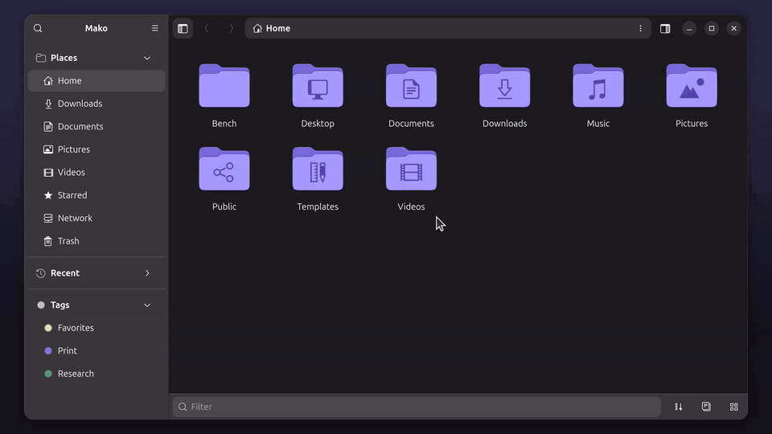
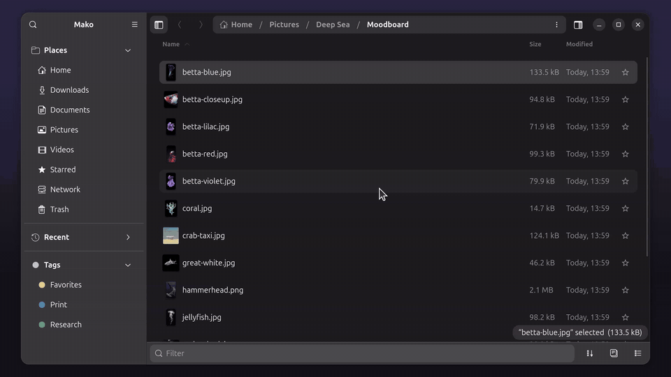
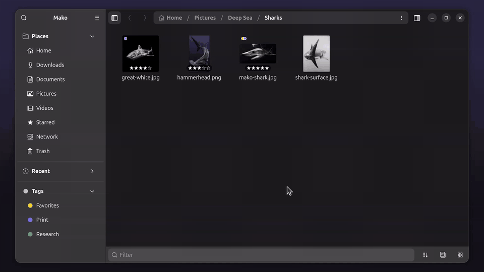
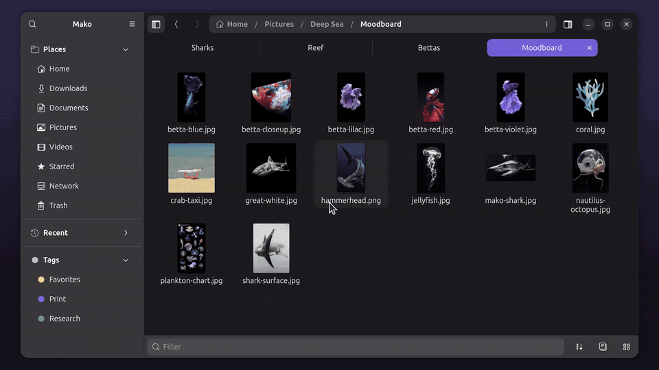
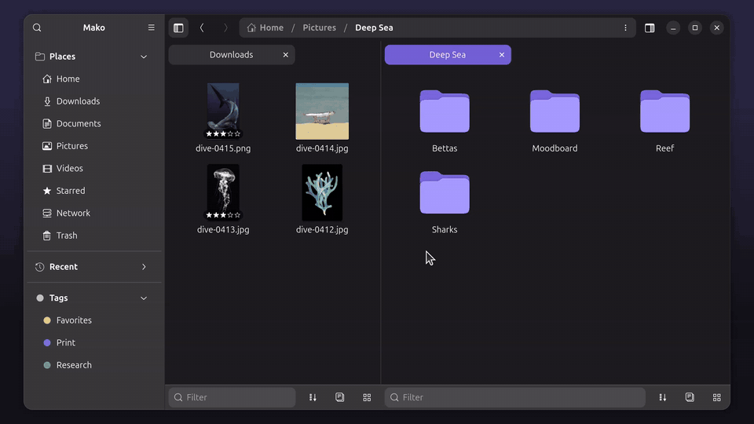
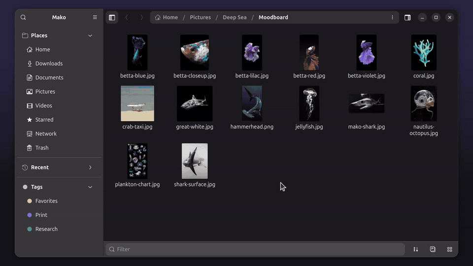
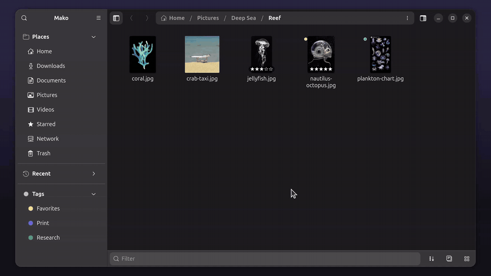
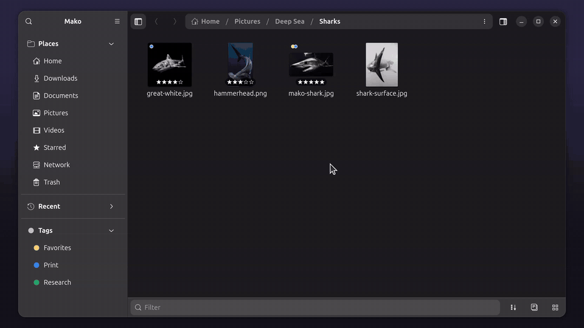
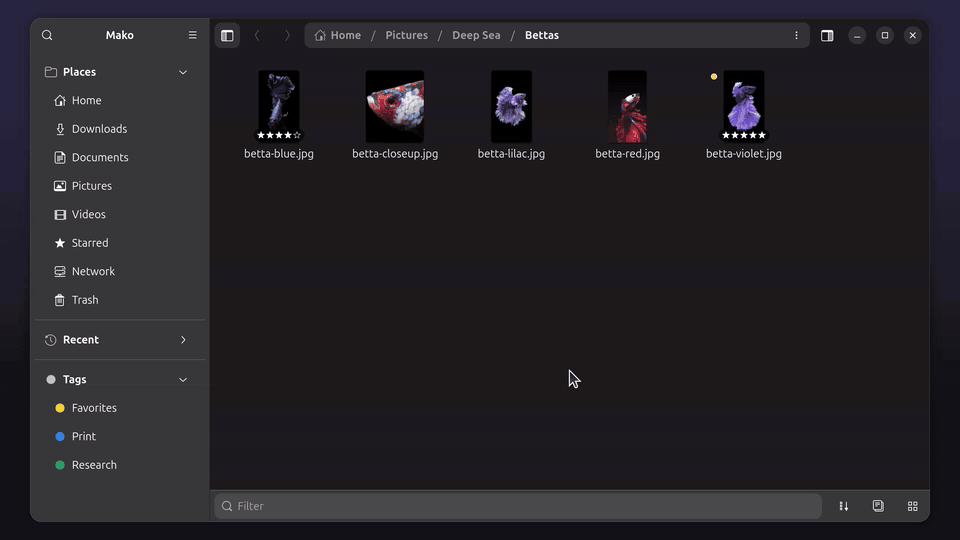

# Mako

**A fast, hotkey-first fork of GNOME Files (Nautilus).**
Split panes with their own tabs, Miller columns, a multi-file Quick Look,
ratings and tags, and a keyboard layout built so that one hand can do
everything while the other stays on the mouse.

It keeps the native GNOME look (GTK 4 and libadwaita) and stays close to
upstream, so it is easy to follow new Nautilus releases. It is based on
Nautilus **50.2.2**.

https://github.com/user-attachments/assets/1a1a578e-7426-485a-a1e6-026c1ab35ce3


> Mako is a personal fork. It is not made or supported by the GNOME
> project. Please report problems here, not to GNOME.

---

## Contents

- [Highlights](#highlights)
- [Views](#views)
- [Tiles and tabs](#tiles-and-tabs)
- [Quick Look](#quick-look)
- [Sidebar](#sidebar)
- [Ratings, tags and colors](#ratings-tags-and-colors)
- [Keyboard: one hand on the keys](#keyboard-one-hand-on-the-keys)
- [Settings](#settings)
- [Build and install](#build-and-install) (also [NixOS and Home Manager](#nixos-and-home-manager))
- [Status](#status)
- [License](#license)

## Highlights

| | |
|---|---|
| **Four views** | List, tree, Miller columns and grid. `Alt+1` to `Alt+4` switch between them. |
| **Tiles** | Split the window into panes, each with its own tab bar. `Ctrl+Tab` goes through every tab of every tile. |
| **Quick Look** | `Space` previews many files at once on a zoomable canvas. Rate, play videos frame by frame and read text files. |
| **Inspector** | A side panel with the preview, rating, tags and details of the selection. Drag its grip to any side of the window, or out of the window to pop it out into its own window. |
| **Ratings and tags** | Stored on the files as extended attributes, the same ones Dolphin uses (`user.baloo.rating`, `user.xdg.tags`). |
| **Sidebar** | Groups you can fold and reorder (Bookmarks, Places, Recent, Tags, Storage). Every item can get a color. |
| **Commands** | `F1` or `Ctrl+K` opens a searchable list of every command, and any key can be changed there. |
| **Key hints** | Each shortcut you press briefly shows its name at the bottom of the window, which helps you learn them. Tooltips show keys too. |
| **Copy progress** | Copies and moves show in a panel in the corner of the window. Paste again while one is running and the new one waits below it, then starts as soon as the first is done. |
| **Look** | A thin bar under each drive in the sidebar shows how full it is. The window can be see-through (Preferences → Appearance → Window Opacity); with the [Blur my Shell](https://extensions.gnome.org/extension/3193/blur-my-shell/) extension's Applications option, what is behind shows blurred. |
| **Bottom bar** | Filter as you type, search, sort and group, flat view, and the view switcher, all in one bar under each tab. |

## Views

List, tree, columns and grid are one key away, and every tab remembers its
own view. In the grid, holding `Alt` shows the star ratings so you can click
to rate.


**Miller columns** work like Finder's. The right column shows what's in
the selected folder. The columns stay put while they fit and only slide
left as far as needed when they don't. One click reveals an item, a double click goes into
it. Drag a column's edge to resize it, or
hold `Alt` while dragging to resize all columns at once. A double click on
an edge resets that column, and `Alt` + double click resets them all.



**Grouping:** `Ctrl+G` steps through grouping by date, first letter,
rating and kind. **Flat view:** `Alt+R` lists every file in all subfolders.


**Density:** four steps from Comfortable (as GNOME Files has it) to Extra
Dense, in the View menu of the bottom bar. The denser steps also draw the
icons smaller, and the sidebar has its own density in its right-click menu.



## Tiles and tabs

`F3` splits to the right and `Shift+F3` splits down. Each tile has its own
tabs, and the active tab is filled with the accent color. `Alt+T` moves to
the next tile, and `Ctrl+Tab` goes through all tabs in all tiles.



Drag a tab to reorder it, or onto another tile to move it there. Drag files
from one tile into a folder in another, and drop a folder on the sidebar to
bookmark it.





## Quick Look

Select files and press `Space`. Several files open on one canvas: zoom with
`W` and `S`, fit with `Q`, see real size with `Z`, rate with `1` to `5` and
move between files with the arrow keys (or `A` and `D`), as in the view
you came from; `Enter` opens the highlighted one. Videos play with `K`, `J` and `L`, and `Shift+A` and
`Shift+D` (or `,` and `.`) step one frame at a time. Text files such as txt,
json, yaml and code are shown as text. PDFs show all their pages: scroll
with the arrow keys, zoom with `W` and `S` or `Ctrl`+scroll, fit with `Q`
(this uses Poppler when it's installed, as it is on Ubuntu). The keys are
listed at the bottom of the panel.

Double-clicking an archive (zip, tar, 7z, rar and so on) extracts it into
the folder it's in.



## Inspector

`Alt+E` shows the inspector: a preview, the rating, tags and details of the
selection, updated as you select. Drag its grip to dock it on another side.



## Sidebar

The sidebar is made of groups you can fold. Drag a group's header (or
right-click it) to move it. Right-click anywhere in the sidebar to switch
groups on or off; single places switch in Preferences. Downloads,
Documents, Pictures and Videos sit in Places. Right-click any item to
color its icon.

Walk the sidebar from the keyboard with `Ctrl+↑` and `Ctrl+↓`. Group
headers are stops too, so this works even when every group is folded.
`Ctrl+←` and `Ctrl+→` fold and unfold the group you're in.



## Ratings, tags and colors

- **Ratings:** 0 to 5 stars. `Ctrl+Alt+1` to `Ctrl+Alt+5` rate the selection, and `` Ctrl+Alt+` `` clears it.
- **Tags:** colored dots next to names, a tag column in the list, and a Tags group in the sidebar. Clicking a tag finds every file with it. `Ctrl+Alt+A` edits the selection's tags.
- **Folder colors:** eight colors in five schemes, from the right-click menu. The rainbow option gives each selected folder the next color.

Ratings and tags are written to the files themselves (extended attributes),
so they move with the files and other apps such as Dolphin can read them.
Tag names and colors are kept in `~/.config/nautilus/tags.json`.




## Keyboard: one hand on the keys

Every common command has a key on the left side of the keyboard, so you can
keep your right hand on the mouse. GNOME's usual keys still work as well.

**[Keyboard map](https://tommkotzu.github.io/mako/keymap/)**: every shortcut
on a keyboard, coloured by what it does, with a layer for each modifier and


for Quick Look and column view.
The layout follows a few simple rules:

- **`Alt` + WASD moves:** `W` goes up, `A` back, `D` forward, `S` opens (goes in). `Alt+Shift+W` goes all the way up, to your home folder.
- **`Alt` + a letter toggles panels and views:** `Q` the sidebar (the key at the left edge, like the sidebar), `E` the inspector ("examine"), `R` the flat view ("recursive"), `V` hidden files ("visible"). `1` to `4` pick the view.
- **`Shift` gives the stronger version:** `Alt+S` opens and `Alt+Shift+S` opens in a new tab. `Alt+X` moves to the trash and `Alt+Shift+X` deletes. `Alt+E` shows the inspector and `Alt+Shift+E` moves it to the next side. `Alt+Q` toggles the sidebar and `Alt+Shift+Q` the bottom bar.
- **`Ctrl+Alt` + a key marks files:** numbers rate, `A` edits tags.
- **`Ctrl` + arrows walk the sidebar.**

<table>
<tr><th>Navigate</th><th>Key</th><th>Panels and views</th><th>Key</th></tr>
<tr><td>Back / Forward</td><td><kbd>Alt</kbd>+<kbd>A</kbd> / <kbd>Alt</kbd>+<kbd>D</kbd></td><td>List / Tree / Columns / Grid</td><td><kbd>Alt</kbd>+<kbd>1</kbd> … <kbd>4</kbd></td></tr>
<tr><td>Parent folder</td><td><kbd>Alt</kbd>+<kbd>W</kbd></td><td>Sidebar</td><td><kbd>Alt</kbd>+<kbd>Q</kbd> (<kbd>F9</kbd>)</td></tr>
<tr><td>Open / in new tab</td><td><kbd>Alt</kbd>+<kbd>S</kbd> / <kbd>Alt</kbd>+<kbd>Shift</kbd>+<kbd>S</kbd></td><td>Inspector / move it</td><td><kbd>Alt</kbd>+<kbd>E</kbd> / <kbd>Alt</kbd>+<kbd>Shift</kbd>+<kbd>E</kbd> (<kbd>F4</kbd>)</td></tr>
<tr><td>Home folder</td><td><kbd>Alt</kbd>+<kbd>Shift</kbd>+<kbd>W</kbd></td><td>Bottom bar</td><td><kbd>Alt</kbd>+<kbd>Shift</kbd>+<kbd>Q</kbd></td></tr>
<tr><td>Enter a location</td><td><kbd>Ctrl</kbd>+<kbd>E</kbd> (<kbd>Ctrl</kbd>+<kbd>L</kbd>)</td><td>Flat view</td><td><kbd>Alt</kbd>+<kbd>R</kbd></td></tr>
<tr><td>Search here / everywhere</td><td><kbd>Ctrl</kbd>+<kbd>F</kbd> / <kbd>Ctrl</kbd>+<kbd>Shift</kbd>+<kbd>F</kbd></td><td>Hidden files</td><td><kbd>Alt</kbd>+<kbd>V</kbd></td></tr>
<tr><td>Sidebar up / down</td><td><kbd>Ctrl</kbd>+<kbd>↑</kbd> / <kbd>Ctrl</kbd>+<kbd>↓</kbd></td><td>Next grouping</td><td><kbd>Ctrl</kbd>+<kbd>G</kbd></td></tr>
<tr><td>Fold / unfold group</td><td><kbd>Ctrl</kbd>+<kbd>←</kbd> / <kbd>Ctrl</kbd>+<kbd>→</kbd></td><td>Zoom in / out</td><td><kbd>Ctrl</kbd>+<kbd>Alt</kbd>+<kbd>W</kbd> / <kbd>S</kbd></td></tr>
<tr><th>Edit</th><th>Key</th><th>Tabs and tiles</th><th>Key</th></tr>
<tr><td>Quick Look</td><td><kbd>Space</kbd></td><td>New / close tab</td><td><kbd>Ctrl</kbd>+<kbd>T</kbd> / <kbd>Ctrl</kbd>+<kbd>W</kbd></td></tr>
<tr><td>Properties ("get info")</td><td><kbd>Alt</kbd>+<kbd>G</kbd></td><td>Next / previous tab (all tiles)</td><td><kbd>Ctrl</kbd>+<kbd>Tab</kbd> / <kbd>Ctrl</kbd>+<kbd>Shift</kbd>+<kbd>Tab</kbd></td></tr>
<tr><td>Move to trash / delete</td><td><kbd>Alt</kbd>+<kbd>X</kbd> / <kbd>Alt</kbd>+<kbd>Shift</kbd>+<kbd>X</kbd></td><td>Reopen closed tab</td><td><kbd>Ctrl</kbd>+<kbd>Shift</kbd>+<kbd>T</kbd></td></tr>
<tr><td>Rename</td><td><kbd>F2</kbd></td><td>Split right / down</td><td><kbd>F3</kbd> / <kbd>Shift</kbd>+<kbd>F3</kbd></td></tr>
<tr><td>New folder</td><td><kbd>Ctrl</kbd>+<kbd>Shift</kbd>+<kbd>D</kbd></td><td>Next / previous tile</td><td><kbd>Alt</kbd>+<kbd>T</kbd> / <kbd>Alt</kbd>+<kbd>Shift</kbd>+<kbd>T</kbd></td></tr>
<tr><td>Invert selection</td><td><kbd>Ctrl</kbd>+<kbd>Shift</kbd>+<kbd>A</kbd></td><td>Reload</td><td><kbd>Ctrl</kbd>+<kbd>R</kbd> (<kbd>F5</kbd>)</td></tr>
<tr><th>Rate and tag</th><th>Key</th><th>App</th><th>Key</th></tr>
<tr><td>Rate 1 to 5 stars / clear</td><td><kbd>Ctrl</kbd>+<kbd>Alt</kbd>+<kbd>1</kbd> … <kbd>5</kbd> / <kbd>Ctrl</kbd>+<kbd>Alt</kbd>+<kbd>`</kbd></td><td>Commands and shortcuts</td><td><kbd>F1</kbd> / <kbd>Ctrl</kbd>+<kbd>K</kbd></td></tr>
<tr><td>Edit tags</td><td><kbd>Ctrl</kbd>+<kbd>Alt</kbd>+<kbd>A</kbd></td><td>Preferences</td><td><kbd>Ctrl</kbd>+<kbd>,</kbd></td></tr>
</table>

Keys in brackets are GNOME's own keys, which keep working. Every key can
be changed in the command list (`F1`): search for a command, click its key
and press a new one.


## Settings

Most of what Mako adds can be switched in **Preferences →
Organize**: the density of the list, grid and columns (comfortable as in GNOME Files,
compact, dense or extra dense, with the icons a standard size or two smaller)
and, separately, of the sidebar, ratings, tags, folder colors and their scheme, the built-in
Quick Look, the progress panel and copying one after another, how see-through the window is, storage bars in the sidebar, shortcut hints, keys in menus, sidebar groups and which
sections and places the sidebar shows. The file density is also in the bottom
bar's View menu, the sidebar's in its right-click menu.

The settings live in the GSettings schema `org.gnome.nautilus.flier`, so
they never touch your normal Nautilus settings.

## Install on Ubuntu

Download `mako_<version>_amd64.deb` from the
[latest release](https://github.com/tommkotzu/mako/releases/latest) and
install it:

```sh
sudo apt install ./mako_*_amd64.deb
```

It is built on Ubuntu 26.04 and needs GTK 4.22 and libadwaita 1.9, so
older releases can't install it. Mako goes into `/opt/mako` and starts with
`mako`. It sits next to the regular Files app and doesn't replace it.
To make it your default file manager, see below. Remove it with
`sudo apt remove mako`.

## Build and install

You need the build dependencies of Nautilus 50, with **GTK 4.22** and
**libadwaita 1.9** or newer. On Debian or Ubuntu,
`sudo apt build-dep nautilus` gets most of them, plus `blueprint-compiler`
and `gettext`.

```sh
git clone https://github.com/tommkotzu/mako.git
cd mako
meson setup _build --buildtype=debugoptimized --prefix="$HOME/.local/nautilus-ff"
ninja -C _build
meson install -C _build
```

The app id is `org.gnome.Nautilus.Devel`, so it installs next to the
regular Files app without replacing it. To run it from that prefix:

```sh
#!/bin/sh
# ~/.local/bin/mako
P="$HOME/.local/nautilus-ff"
export GSETTINGS_SCHEMA_DIR="$P/share/glib-2.0/schemas"
export XDG_DATA_DIRS="$P/share:${XDG_DATA_DIRS:-/usr/local/share:/usr/share}"
export LD_LIBRARY_PATH="$P/lib/x86_64-linux-gnu:$LD_LIBRARY_PATH"
exec "$P/bin/nautilus" "$@"
```

To make it your default file manager:

```sh
xdg-mime default org.gnome.Nautilus.Devel.desktop inode/directory
```

Undo it with `xdg-mime default org.gnome.Nautilus.desktop inode/directory`.

To make Mako the open/save dialog for other apps (browsers, Flatpaks and
anything else that uses the desktop portal), run
`tools/file-chooser.sh install`. `tools/file-chooser.sh uninstall` brings
back GNOME's dialog.

### NixOS and Home Manager

The repository is a flake. It is new and has not been built on NixOS yet,
so please open an issue if something fails. Try it without installing:

```sh
nix run github:tommkotzu/mako
```

Add it to your flake inputs:

```nix
inputs.mako.url = "github:tommkotzu/mako";
```

The option is `programs.mako-files`, because `mako` is already the name of
a notification daemon in nixpkgs and Home Manager.

**NixOS** (system-wide):

```nix
{ inputs, ... }: {
  imports = [ inputs.mako.nixosModules.default ];

  programs.mako-files = {
    enable = true;
    defaultFileManager = true; # open folders with Mako
    fileChooser = true;        # Mako as the open/save dialog for other apps
    settings = {               # defaults; users can still change them
      folder-color-scheme = "vibrant";
      bottom-bar = true;
    };
  };
}
```

**Home Manager** (per user):

```nix
{ inputs, ... }: {
  imports = [ inputs.mako.homeManagerModules.default ];

  programs.mako-files = {
    enable = true;
    defaultFileManager = true;
    fileChooser = true;
    settings = {
      folder-color-scheme = "vibrant";
      inspector-side = "right";
      sidebar-hidden-places = [ "music" ];
    };
    bookmarks = [ "file:///home/me/Projects Projects" ]; # optional; makes the bookmarks read-only
  };
}
```

`settings` takes any key from
[`data/org.gnome.nautilus.flier.gschema.xml`](data/org.gnome.nautilus.flier.gschema.xml).
The flake also has `packages.<system>.default` (`mako-files`),
`overlays.default` and a `devShells.default` for hacking on Mako.

## Status

Mako is used daily, but it is young. All changes are on the
`ff/split-panes` branch, one commit per feature, on top of Nautilus
50.2.2. New code goes into its own files where possible (for example
`nautilus-shortcuts.c`, `nautilus-quick-look.c`, `nautilus-columns.c`,
`nautilus-labels.c`, `nautilus-inspector.c`, `nautilus-bottom-bar.c` and
`nautilus-tile-layout.c`), which keeps following upstream easy.

Many ideas come from [File pilot]([https://github.com/andrew11155/FileFlier](https://filepilot.tech)),
a file manager developed for windows - go support the project

The README pictures were taken from inside the app (run with
`FLIER_CAPTURE=1`) in a demo home folder.

## License

GPL-3.0-or-later, like Nautilus. See [LICENSE](LICENSE). The icon is the Files icon of the
[Yaru](https://github.com/ubuntu/yaru) theme (CC-BY-SA 4.0). GNOME's original
README is in [README.nautilus.md](README.nautilus.md).
